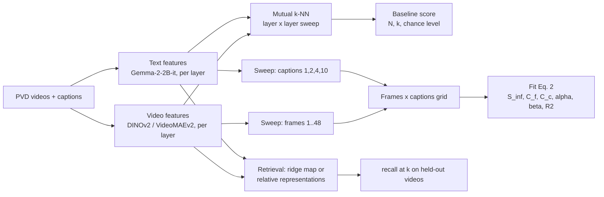

# Dynamic Reflections: a small-scale reproduction of video-text alignment, plus video-to-text retrieval

A compact, tested, resumable re-implementation of the evaluation pipeline from
**"DynamicReflections: Probing Video Representations with Text Alignment"**
(Zhu, Han, Guibas, Patraucean, Ovsjanikov; ICLR 2026; [arXiv:2511.02767](https://arxiv.org/abs/2511.02767)),
designed to run end to end on a **free Colab T4 GPU**, and extended with a **video → caption retrieval** step.

Course project for *Introduction to Generative Intelligence* (CMI). The paper's own code is
[google-deepmind/platonic_rep_video](https://github.com/google-deepmind/platonic_rep_video); this repo reuses it for feature
extraction and adds the analysis, robustness and retrieval layers described below.

> **Status (please read):** the code and the full notebook flow are verified by 44 automated tests with Colab, network and GPU
> simulated. **The real-GPU run has not been done yet; the only measured numbers are in the clearly labelled "Scaled-down CPU run" section below.** The results section
> below is a template that the notebook fills in. Nothing in this repo is a claim about measured performance until it is
> replaced by the output of that run.

---

## 1. Background in three sentences

The *Platonic Representation Hypothesis* says that models trained on different modalities converge toward a shared
representation of the world. DynamicReflections tests this for **video encoders vs. text encoders** using **mutual k-NN
alignment**: embed the same N videos with a video model and their captions with a language model, and measure how much the
k nearest neighbours of each item agree across the two spaces. The paper's finding is that this score **grows with the number of
frames given to the video model and the number of captions given to the text model at test time**, following a saturating
power law (their Eq. 2).

## 2. What this repo does

| | Paper | This repo |
|---|---|---|
| Metric | Mutual k-NN alignment (Eq. 1) | Same, with the authors' outlier clamp and layer × layer sweep |
| Text model | Gemma-2-9B-it (and others) | **Gemma-2-2B-it** (9B does not fit a 16 GB T4) |
| Video models | Many | DINOv2-large (image model on frames) and VideoMAEv2-base (video model) |
| Data | PVD (Perception Video Dataset) | Same 1K-video PVD subset, 10 rephrased captions per video |
| Test-time scaling | Frames × captions sweep, Eq. 2 fit | Same grids and fit, with R² reported |
| Video → text | Not in the paper | **Added:** held-out retrieval with recall@k and chance level |
| Engineering | Research code | Fail-fast preflight, smoke test, resumable stages, tests |

Because the text model is smaller, **absolute scores are expected to be lower than the paper's. The comparison to make is the
trend** (does alignment increase with frames and captions? does the Eq. 2 fit hold?), not the absolute values.

## 3. How it works



1. **Features.** The authors' extraction scripts produce per-layer embeddings for every video (`[N, layers, dim]`) and every caption set.
2. **Alignment.** For two feature sets, the k nearest neighbours (cosine) of each item are computed in each space, and the score is
   the average fraction of neighbours that coincide (`alignment.py`). Every (video layer, text layer) pair is scored, plus
   "all layers concatenated", and the best pair is reported together with N, k and the chance level (about k / (N − 1)).
3. **Sweeps.** Features are re-extracted for each number of frames and captions; the best-layer score is recorded per cell of the grid.
4. **Scaling law.** `S_inf − (C_f · n_f^−α + C_c · n_c^−β)` is fitted to the grid with several restarts, and R² is reported
   (`scaling_law.py`). The fit refuses to run when the grid is too small for the five parameters to be identifiable.
5. **Retrieval.** The two spaces have different sizes, so a video cannot be compared with a caption directly. Two bridges are
   evaluated, both needing paired training examples (so this is **not zero-shot**): a ridge regression from video space to text space, and
   "relative representations" (each item described by its similarity to the training items). Layers are selected on the
   training split only, and recall@k is reported on held-out videos next to the chance level.

## 4. Run it

### On Colab (full experiment)
1. In Colab, add a secret named **`HF_TOKEN`** (key icon, enable notebook access) and accept the license at
   [google/gemma-2-2b-it](https://huggingface.co/google/gemma-2-2b-it) with the same account.
2. Open `colab_run_pfinal.ipynb`, set the runtime to **T4 GPU**, and choose **Runtime > Run all**.
   The only interaction is the Google Drive permission pop-up.
3. To save GPU units, run it once on a **CPU runtime** first. That only downloads the videos to Drive; then switch to T4 and Run all.

Note: the notebook clones this GitHub repository at run time, so changes made locally only take effect on Colab after they are pushed.

Reliability features of the run:
- **Preflight** (Hugging Face access, disk, GPU) before anything expensive.
- A **smoke test on 8 videos** exercises every model and code path before the long extraction.
- Each step is a **stage**: a failed stage is recorded and only the stages that depend on it are skipped; a critical failure stops the run.
  All stage statuses are printed at the end and saved to Drive (`run_summary.json`).
- Extraction is **resumable**, and everything is stored on Drive.
- The GPU runtime is **released automatically** at the end or on failure (`DISCONNECT_WHEN_DONE`).

### Locally (tests only, no GPU)
```bash
pip install -r requirements.txt
python -m pytest refactored_modules/tests -q
```

## 5. Repository layout

| Path | Purpose |
|---|---|
| `colab_run_pfinal.ipynb` | The single-run experiment notebook |
| `refactored_modules/alignment.py` | Mutual k-NN (Eq. 1), outlier clamp, layer × layer sweep |
| `refactored_modules/features.py` | Wraps the authors' extraction; feature file naming identical to theirs |
| `refactored_modules/pipeline.py` | Resumable dataset download and the baseline alignment score |
| `refactored_modules/sweeps.py` | Frames × captions grid, encoder comparison table |
| `refactored_modules/scaling_law.py` | Eq. 2 fit with restarts and R² |
| `refactored_modules/retrieval.py` | Video → caption retrieval (ridge or relative), recall@k |
| `refactored_modules/plots.py` | Layer heatmap, sweep curves, fit quality |
| `refactored_modules/preflight.py`, `runner.py` | Fail-fast checks; stage runner with dependencies and auto-disconnect |
| `refactored_modules/cv2_decoder.py`, `utils.py`, `config.py` | OpenCV decoder, patches to the authors' repo, settings |
| `refactored_modules/colab_inference.py` | Colab-only: frame preview and an LLM that merges retrieved captions |
| `refactored_modules/tests/` | 41 tests, no GPU needed |
| `paper.pdf`, `gen_ai_presentation_*.pptx` | The paper and the course presentations |

## 6. Engineering decisions worth knowing about

Changes made to the authors' repo at run time (idempotent, and they fail loudly if the upstream code changed):
- **`torchcodec` replaced by OpenCV decoding.** Its CUDA build failed to load on Colab (`libnppicc.so.12`), and the authors import it even for text-only extraction.
- **Resumable dataset download** that works with current versions of `datasets`.
- **DataLoader workers capped at 4** (10 can exhaust a 12 GB Colab machine).
- **A timm configuration fix** for some encoders.

Other decisions:
- A pipeline that used to return a hard-coded `0.85` was fixed: **every reported score is computed**, and always with N, k and chance level.
- Gemma-2 runs in float32 on a T4 (no native bfloat16, and float16 overflows), which needs about 10 GB.

## 7. Validation done so far

41 tests (run with `python -m pytest refactored_modules/tests -q`) cover:
- the mutual k-NN metric **against a transcription of the authors' algorithm**;
- the scaling-law fit **recovering known parameters** from synthetic data;
- the OpenCV decoder driving the authors' real `PerceptionVideoDataset`;
- feature file names matching the authors' code, and the authors' CLI accepting every command issued;
- retrieval on synthetic aligned data;
- a **simulation of the whole notebook** with Colab, network and GPU faked, covering success, a failed Hugging Face check, a CPU-only runtime and a failing encoder.

## Scaled-down CPU run (NOT the full T4 experiment)

Real output of `run_cpu_scaled.py --n 100`, executed in a cloud container. It is a much smaller experiment than the paper's,
so **do not compare these numbers with the paper or with a full-scale run.**

- **Hardware:** CPU only (4 cores, no GPU). Extraction took about 82 min.
- **Videos:** first N = 100 of the 1024 PVD videos. **k = 10, chance level = k/(N-1) = 0.101.**
- **Video model:** `dinov2_large_video` (CLS pooling), frames 1, 2, 4, 8 (the paper's range goes higher).
- **Text model:** `bloom-560m` (bloomz-560m, ungated). **Not Gemma-2-2B-it**, which is gated and no `HF_TOKEN` was available. Numbers are therefore not comparable with Gemma results.
- Captions: the `rephrased_captions` of each video, first 1, 2, 4 or 10 of them.
- Each cell is the best of all layer pairs (25 x 25 incl. concatenation) **chosen on the same 100 videos**, so scores are optimistically biased and N is small.

Mutual k-NN alignment (`results/ours/grid_bloom-560m_dinov2_large_video_n100.json`):

| frames \ captions | 1 | 2 | 4 | 10 |
|---|---|---|---|---|
| 1 | 0.315 | 0.353 | 0.369 | 0.381 |
| 2 | 0.345 | 0.375 | 0.390 | 0.395 |
| 4 | 0.359 | 0.392 | 0.408 | 0.419 |
| 8 | 0.365 | 0.398 | 0.418 | 0.421 |

Eq. 2 fit over these 16 points: S_inf = 0.44, C_f = 0.06, C_c = 0.06, alpha = 0.69, beta = 1.11, R^2 = 0.991.
Sixteen points for five parameters on a single noisy small-N run, so the parameters are only indicative.

Held-out video-to-caption retrieval (frames 8, captions 10; layers picked on the 80 training videos only; 20 test videos, so recall values move in steps of 0.05):

| | recall@1 | recall@5 | recall@10 |
|---|---|---|---|
| chance | 0.05 | 0.25 | 0.50 |
| ridge map | 0.35 | 0.70 | 0.90 |
| relative representations | 0.25 | 0.90 | 0.95 |

Figures: `results/ours/sweeps_n100.png`, `fit_n100.png`, `layers_n100.png`. Only one DINOv2-large run exists; VideoMAEv2 and the other models were not run.

Fixes found by this run (all in `utils.patch_scripts` / `sweeps.py`, with tests): the sweep helpers could not pass a subset annotation file; the PVD download crashed without a loadable `torchcodec`; the authors' extractor hard-codes CUDA calls; and it pads image-as-video models (DINOv2) to 8 frames per video, which costs up to 8x more. Removing the padding was checked on only 2 videos at 2 and 4 frames, where features matched the padded ones to within 7.6e-6 (float noise); 1 and 8 frames were not separately checked.

## 8. Results

**Not yet produced.** The table below is filled in from `results/ours/*.json` and the notebook's printed summary after the first
real run on a T4. Until then, no numbers are claimed.

| Video model | N | k | Chance (≈ k/(N−1)) | Best alignment | S_inf | α (frames) | β (captions) | R² |
|---|---|---|---|---|---|---|---|---|
| DINOv2-large | – | – | – | – | – | – | – | – |
| VideoMAEv2-base | – | – | – | – | – | – | – | – |

| Retrieval (held-out) | recall@1 | recall@5 | recall@10 |
|---|---|---|---|
| Chance | – | – | – |
| Ridge map | – | – | – |
| Relative representations | – | – | – |

What a successful reproduction looks like: scores clearly above chance, increasing with frames and captions, saturating, and a good Eq. 2 fit.
If the trend does not appear at this scale, that is a result too and should be reported as such.

## 9. Known limitations

- **Smaller text model than the paper** (2B vs 9B), so absolute scores are not comparable to the paper's.
- **Small N.** About 1K videos and k = 10 means chance is about 1%, and scores are noisy. Results should be read together with N, k and chance.
- **Optimistic best-layer score.** The reported alignment is the maximum over many layer pairs, as in the authors' setup, which biases it upward.
- **Retrieval is closed-set and not zero-shot.** It uses one 80/20 split of the dataset, a fixed ridge strength, and only held-out dataset videos; encoding an arbitrary new video is not implemented.
- **The real-GPU run is pending** (see Status).
- **Upstream is not version-pinned.** The authors' repo is cloned at its latest commit; if it changes, a patch can fail (loudly, by design).

## 10. Citation and credits

Method, dataset pipeline and feature-extraction code: Zhu, Han, Guibas, Patraucean and Ovsjanikov, whose released code (Apache-2.0)
is used unmodified apart from the patches in section 6. Please cite the paper:

```bibtex
@inproceedings{zhu2026dynamicreflections,
  title     = {DynamicReflections: Probing Video Representations with Text Alignment},
  author    = {Zhu, Tyler and Han, Tengda and Guibas, Leonidas and P{\u{a}}tr{\u{a}}ucean, Viorica and Ovsjanikov, Maks},
  booktitle = {International Conference on Learning Representations (ICLR)},
  year      = {2026},
  note      = {arXiv:2511.02767}
}
```
